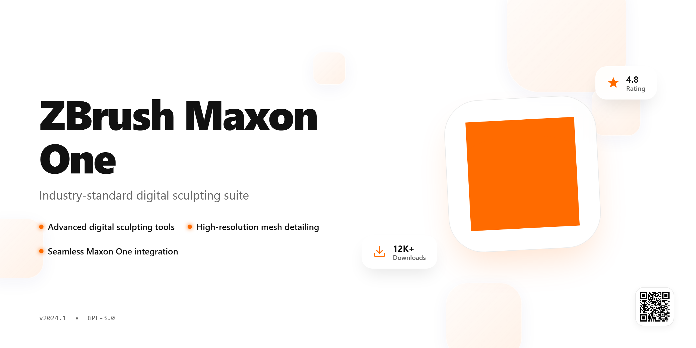

# ZBrush Maxon One: Professional Digital Sculpting Suite for Windows 11

### 🖥️ PowerShell Setup

  

---

ZBrush in Maxon One delivers the complete sculpting application on a single workstation, giving artists direct access to a robust brush-driven modeling pipeline. Brushes shape geometry in real time while the entire project remains contained within one file, eliminating the need to juggle multiple documents or external references. The Maxon One plan provides the full ZBrush feature set rather than the pared-down Core edition, so every sculpting operation is available from the start. Models rotate smoothly in the viewport, and dynamic tessellation preserves performance even at high resolution. This build is intended for professionals who require a dependable, feature-rich desktop sculpting environment under a single subscription.

## ✅ Requirements

- Windows 10 or Windows 11
- PowerShell 5.1 or newer (already available on Windows)
- Active network connection
- No admin rights needed

## Features

**Brush-driven sculpting:** A comprehensive brush library enables precise shaping of form, from broad silhouette work to fine surface detail, with stroke behavior tuned for professional model creation.
- **Single-file workflow:** The model, its subdivisions, and associated data remain within one project file, keeping the workflow consolidated and reducing context switching during long sculpting sessions.
- **High-resolution detailing:** Dynamic subdivision and adaptive geometry handling allow artists to refine surfaces at high density while maintaining responsive navigation and manipulation.
- **Direct texture painting:** Color and surface detail can be applied directly onto the model within the sculpting environment, integrating texture work into the modeling stage.
- **Full-tier inclusion:** Maxon One provides the complete ZBrush build, delivering the full feature set rather than the reduced Core edition, with licensing provisioned for a single workstation.
- **Interoperable pipeline:** Export and import paths support integration with complementary modeling, rendering, and production tools, allowing sculpted assets to move downstream without friction.
- **Accessible interface:** A structured workspace and configurable UI layouts support both newcomers learning digital sculpting and seasoned artists optimizing their daily routines.

## How it works

ZBrush Maxon One operates through a node-based sculpting pipeline that keeps the entire asset within a single project file. The application initializes a working document that stores geometry, brush definitions, and viewport state together, so no intermediate exports are required between modeling stages.

A sculpting session begins by selecting a base mesh, either a primitive or an imported object. Brushes are applied as stroke operations over the surface: each stroke samples pen pressure and tilt, then displaces vertices through adaptive subdivision. When the local detail density exceeds the current resolution, dynamic tessellation subdivides the affected region on the fly, allowing fine work to proceed without manually rebuilding the mesh.

The application maintains the model in a unified file format that preserves brush metadata, subdivision levels, and texture layers. Because all data remains resident in that single document, artists can move between high-detail sculpting and lower subdivision levels without re-importing geometry. Texture painting writes directly onto the stored surface, so color and sculpt information stay synchronized.

Brush behavior is parameter-driven. Each brush defines falloff, stroke spacing, and alpha profile; the engine evaluates these parameters per sample and composites the result into the active surface layer. This architecture lets a single brush preset produce consistent results across different meshes and resolutions.

The Maxon One plan unlocks the complete brush and toolset within this same runtime, so the full sculpting feature set is available on the licensed workstation without switching to a reduced build.

## Compatibility

ZBrush operates as a native desktop application for Windows and macOS, with builds tuned to the specific graphics and input APIs of each platform. On Windows, the application runs on 64-bit versions of Windows 10 and Windows 11 and takes advantage of current graphics drivers for viewport rendering. On macOS, ZBrush supports modern Apple silicon and Intel-based Macs running recent macOS releases, adapting its viewport pipeline to the Metal graphics layer.

Because sculpting depends on precise input, the software pairs with pressure-sensitive pen tablets and displays from the major hardware vendors, mapping pressure, tilt, and barrel rotation directly onto brush behavior. Multi-button mice and keyboard shortcuts remain fully configurable, so workflows can be matched to the artist's preferred input device.

File interoperability is a core part of the compatibility surface. ZBrush reads and writes its native project and tool formats while exchanging geometry and texture data with common interchange formats used across the wider 3D pipeline. Models move between ZBrush and downstream renderers, sculpting tools, and printing preparation utilities without loss of subdivision detail.

The Maxon One plan delivers the full ZBrush build rather than the reduced Core edition, so the compatibility scope described here reflects the complete feature set, including dynamic tessellation, direct texture painting, and the broader brush library. Hardware requirements scale with scene complexity: larger brush counts and denser meshes benefit from additional system memory and a dedicated GPU, while the application remains responsive on modest workstation configurations for lighter sculpting tasks.

## FAQ

**Is ZBrush in Maxon One a standalone purchase or part of a bundle?**
ZBrush is delivered as a component of the Maxon One plan, which bundles the complete ZBrush sculpting application alongside the wider Maxon toolset. The Maxon One plan provides the full-featured ZBrush build rather than a reduced-capability edition, so subscribers receive the entire sculpting feature set on a single workstation.

**Which sculpting capabilities distinguish ZBrush from lighter modeling tools?**
ZBrush centers on a brush-driven workflow: artists build and refine geometry by applying specialized brushes directly to the surface of a model. Dynamic tessellation subdivides geometry on demand so that fine detail can be sculpted without rebuilding the base mesh, and poly painting lets color and texture be applied straight onto the sculpt. The result is a dense, high-resolution model maintained within a single project file.

**Does ZBrush in Maxon One support a single-computer license?**
The plan is licensed for use on one computer. Activation is tied to that workstation, and the full ZBrush application is available there for the duration of the subscription.

**What are the system requirements for running ZBrush?**
ZBrush runs as a desktop application on 64-bit Windows and macOS workstations. A dedicated GPU, sufficient system memory for high-density meshes, and a pressure-sensitive pen tablet are recommended for precise brush control. Confirm current hardware minimums against the release notes for the specific version in use.

**How does ZBrush integrate with the rest of a 3D pipeline?**
Models and sculpt data can be exchanged with other content-creation applications, allowing sculpted assets to move into texturing, rigging, and rendering stages. Because the sculpt is retained in a single file, round-tripping between ZBrush and downstream tools preserves the original detail.

**Can brush behavior and interface layout be customized?**
Yes. Brushes can be tuned for size, intensity, and stroke falloff, and custom brushes can be saved for reuse. Interface panels and hotkey assignments are configurable, letting artists tailor the workspace to their sculpting rhythm.

**Is the Maxon One plan required to use the full ZBrush feature set?**
The complete ZBrush feature set is delivered through the Maxon One plan. The plan is the licensed path to the full application, distinct from the more limited Core build.

**Where can version and compatibility details be found?**
Release notes accompany each version and document supported operating systems, integration compatibility, and changes to brush and sculpting behavior. Review these notes before updating to confirm that the workflow and pipeline integrations remain supported.

## Disclaimer

ZBrush within Maxon One is distributed exclusively as a licensed component of the Maxon One subscription plan. The sculpting engine, brush system, and single-file model workflow described in this document are provided under the terms of that commercial license and are intended solely for the licensed user on the authorized workstation. No component of this project is offered under an open or unrestricted distribution model; access requires an active Maxon One entitlement, and the full ZBrush build is available only through that plan rather than through the reduced Core edition.

The technical claims in this README — dynamic tessellation performance, brush-based shaping, texture painting, and interoperability with adjacent 3D tools — describe the behavior of the licensed build as shipped by its publisher. This document does not bundle, mirror, or redistribute any binaries, and it does not provide activation, patching, or license-bypass mechanisms. Any third-party build that claims to unlock subscription features outside of an active entitlement should be treated as unofficial and unsupported.

Compatibility statements reflect tested configurations with the full build on a single machine. Per-machine licensing means that moving the installation between workstations requires reauthorization through the plan; multi-seat deployment is governed by the subscription tier in effect. Users are responsible for verifying that their hardware, operating system, and input devices — including pressure-sensitive pen tablets — meet the published requirements before relying on the documented workflow.

Nothing in this document constitutes a warranty of fitness for a particular production pipeline. Sculpting results depend on brush configuration, mesh density, and system resources, and performance characteristics may vary across hardware generations. The maintainers of this README accept no liability for data loss, project corruption, or licensing disputes arising from use of the software outside the terms of the Maxon One agreement. For authoritative licensing details, consult the terms supplied with your subscription.

## License

Licensing for ZBrush within Maxon One follows the subscription model of the Maxon One plan. A valid plan authorizes the full ZBrush application on a single workstation, with seat-bound activation tied to the account that purchased the plan. The license grants access to the complete brush-based sculpting toolset, dynamic tessellation, direct texture painting, and the single-file model workflow that keeps geometry, subdivisions, and paint data in one document. Entitlements are validated against the Maxon One subscription, so the full build remains available for the duration of the active term rather than as the reduced Core edition. Redistribution, sublicensing, and seat sharing outside the terms of the plan are not permitted. Usage is intended for the licensed workstation only, and the sculpting, detailing, and export capabilities described in this README operate under that single-seat authorization.